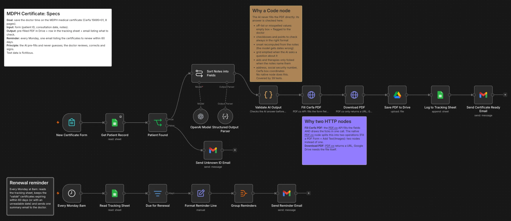

# MDPH Certificate: AI pre-filling with n8n

M1 Eugenia project. An n8n workflow that helps a French doctor fill in the MDPH medical certificate
(Cerfa 15695*01, 8 pages) from consultation notes, then reminds them which certificates to renew.

> All data is **fictitious** (patients, doctor "Dr Claire Exemple", RPPS number).


*Top: new certificate branch. Bottom: weekly renewal reminder. Sticky notes give the specs and explain the Code and HTTP nodes.*

## Demo video

**Video:** _link to be added_
If the link is unavailable or has expired, read the [transcript](video/transcript.md).

## What the workflow does

**Branch 1: new certificate** (n8n form)
1. The doctor enters the patient ID, the consultation date and their notes.
2. The patient record is read from Google Sheets; an unknown ID triggers an email instead.
3. **gpt-6-luna** sorts the notes into the certificate fields, without inventing anything.
4. A Code node checks the AI answer before anything reaches the PDF.
5. PDF.co fills the official Cerfa; the PDF is saved to Google Drive and logged in a tracking sheet.
6. The doctor receives an email with the link and the points to check before signing.

**Branch 2: renewal reminder** (every Monday at 8am)
Reads the tracking sheet and emails the doctor the certificates expiring within 60 days.

The form, the emails and the PDF stay in French (French doctor, French official form).

## Repository

| Folder | Content |
|---|---|
| `workflows/` | `MDPH Certificate.workflow.ts`, the workflow as code (n8n SDK, `n8ncli`), and `tests/`, 39 automated tests |
| `skills/` | The 3 Claude Code skills built for this project (see below) |
| `video/` | The demo video transcript |

## Design choices

- **One Code node, on purpose.** The AI never fills the PDF directly: the Code node rejects off-list values,
  forces checkboxes to true/false, recomputes the onset date from the notes (the model gets date arithmetic
  wrong), empties any grid the AI asks a question about, unticks any aid or therapy the notes do not name, cleans the address and social security number,
  and maps the Cerfa box coordinates. No native node does this.
- **Two HTTP nodes, on purpose.** *Fill Cerfa PDF* fills the form fields **and** draws the ticks in a single
  PDF.co call; the native PDF.co node splits this into two operations, so it would take two nodes.
  *Download PDF* is needed because PDF.co returns a URL while Google Drive needs the file.
- **Sticky notes** on the canvas give the specs and explain these choices.

## AI reliability

The prompt was benchmarked on 6 different sets of notes (osteoarthritis, stroke, autistic child, work
accident, poor notes, vague difficulties), 3 runs each. A run passes if it fills what the notes clearly say
and invents nothing.

| Version | Model | Clean runs |
|---|---|---|
| Original prompt | gpt-4o-mini | 11/18 |
| Rewritten prompt, first draft | gpt-4o-mini | 11/18 (with invented answers) |
| Fixed prompt + Code node checks | gpt-4o-mini | 16/18 |
| **Final: English prompt + Code node checks** | **gpt-6-luna** | **18/18, twice** |

## Claude Code skills

- **interview**: interviews the user one question at a time to turn a vague idea into a locked spec
  (every fact is CONFIRMED, ASSUMED or OPEN).
- **doubt-driven-dev**: builds while doubting everything; every assumption is tested with the expected
  result written first, and a test only counts once it has been seen failing.
- **hostile-review**: adversarial review of work declared done, ending with a SHIP / DO NOT SHIP verdict.

To use them, copy the folders from `skills/` into `~/.claude/skills/`.

## Run the tests

```bash
npm install
npm test
```

The tests replay the Code node and the n8n expressions locally (no network, no credits): missing or badly
formatted address and social security number, off-list AI values, onset date computation, French date
formats, aids not named in the notes, PDF box positions. Expected result: `39/39 TRUE`.

## Setup

1. Import `workflows/MDPH Certificate.workflow.ts` with `n8ncli` (tested with version **1.2.45**), or convert
   it to JSON and use **Import from File** in n8n.
2. Connect the credentials: OpenAI, Google Sheets, Google Drive, Gmail, PDF.co.
3. Create a Google Sheet with two tabs:
   - `Patients`: `id_patient`, `nom`, `prenom`, `date_naissance`, `sexe`, `adresse`, `code_postal`, `ville`,
     `num_secu`, `pathologie`, `traitements`
   - `Suivi`: `id_patient`, `date_consultation`, `date_echeance`, `lien_pdf`, `a_verifier`, `statut`
4. Replace the recipient email address in the Gmail nodes.

## Limitations

- **Health data:** notes are sent to OpenAI and PDF.co, which are not certified French health data hosts
  (HDS). Real patients would require compliant providers.
- The doctor always reviews, completes page 7, dates and signs: the AI only pre-fills.
- Local tests do not check the final PDF rendering; that was checked manually on real runs.
